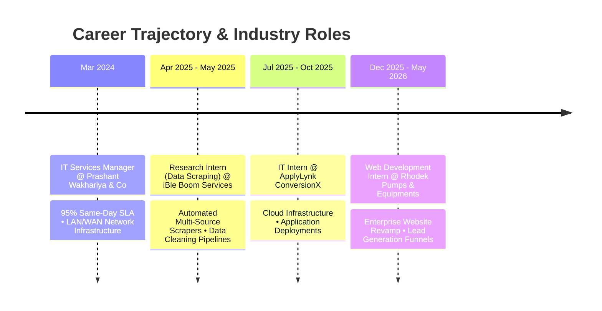

<div align="center">

# Romil Doshi

**Software engineer focused on backend systems, data pipelines, and applied AI/ML**

Final-year B.Tech Computer Engineering | Mumbai, India
<div align="center">

<!-- Hero Waving Header Banner -->


<br/>

<!-- Dynamic Animated Typing Banner -->
<a href="https://github.com/Romil157">
  
</a>

<br/><br/>

<!-- Status Pill Badges -->
[](mailto:romildoshi1999@gmail.com)
[-0969da?style=for-the-badge&logo=academia&logoColor=white)](https://mu.ac.in)
[](https://maps.google.com/?q=Mumbai)

<br/>

<!-- Interactive Quick Links -->
[](https://www.linkedin.com/in/romil-doshi147/)
[](mailto:romildoshi1999@gmail.com)
[](https://github.com/Romil157)
[](https://github.com/Romil157)

<br/>

<p align="center">
  <a href="#-about-me"></a>
  <a href="#-core-engineering-pillars"></a>
  <a href="#-technical-arsenal"></a>
  <a href="#-featured-projects"></a>
  <a href="#-professional-experience"></a>
  <a href="#-hackathons--competitions"></a>
  <a href="#-github-analytics"></a>
  <a href="#-connect--collaborate"></a>
</p>

<p align="center">
  <b><a href="#-about-me">About Me</a></b> &nbsp;•&nbsp;
  <b><a href="#-core-engineering-pillars">Core Pillars</a></b> &nbsp;•&nbsp;
  <b><a href="#-technical-arsenal">Tech Stack</a></b> &nbsp;•&nbsp;
  <b><a href="#-featured-projects">Projects</a></b> &nbsp;•&nbsp;
  <b><a href="#-professional-experience">Experience</a></b> &nbsp;•&nbsp;
  <b><a href="#-hackathons--competitions">Hackathons</a></b> &nbsp;•&nbsp;
  <b><a href="#-github-analytics">Analytics</a></b> &nbsp;•&nbsp;
  <b><a href="#-connect--collaborate">Contact</a></b>
</p>

</div>

---

## 👨‍💻 About Me

Final-year **Computer Engineering** undergraduate (**B.Tech, Expected 2027**) at the **University of Mumbai** with proven industry experience across **backend architecture, high-volume data scraping & cleaning pipelines, browser edge security, and applied AI/ML systems**.

- 🎓 **Education:** Final-Year B.Tech in Computer Engineering — **University of Mumbai** *(2023 – 2027)*
- 💡 **Engineering Philosophy:** Designing resilient, low-latency systems that turn messy real-world data into structured intelligence and deliver on-device user protection.
- 🛡️ **Edge Security & AI:** Creator of **[Trustos](https://github.com/Romil157/trustos-project)** (zero-trust browser extension combining WebAssembly and local Bloom filters) and **[Sentinel Verify](https://github.com/Romil157/sentinel)** (an AI/NLP-driven threat classification SaaS).
- 🏆 **Global Finalist:** Ranked **#445 of 12,885+ registrants across 48 countries (Top 3.4%)** at **HackerRank Orchestrate Hackathon 2026** for building an autonomous multi-ecosystem AI support triage agent.
- 💼 **Industry Background:** 4 professional internships and roles covering web platform revamps, enterprise cloud & IT infrastructure support, automated data pipelines, and technical systems administration.
- 🎯 **Looking For:** **Software Development Engineer (SDE) / Data / Applied AI-ML Internships** *(Mumbai or Remote)*.

---

## 🏛️ Core Engineering Pillars

<table>
  <tr>
    <td width="50%" valign="top">
      <h3>🛠️ Backend & Full-Stack Systems</h3>
      <p>Building high-throughput REST APIs, robust web architectures, and responsive user interfaces with Flask, Node.js, and modern JavaScript with strict focus on performance and reliability.</p>
      <p><code>Flask</code> • <code>Node.js</code> • <code>RESTful APIs</code> • <code>SQLAlchemy</code> • <code>HTML5/CSS3</code></p>
    </td>
    <td width="50%" valign="top">
      <h3>📊 Data Engineering & Scraping</h3>
      <p>Designing automated multi-threaded web scrapers, ETL pipelines, and validation engines to extract, sanitize, and structure raw web data into research-grade datasets.</p>
      <p><code>Data Scraping</code> • <code>Data Cleaning</code> • <code>Pandas</code> • <code>NumPy</code> • <code>SQL</code></p>
    </td>
  </tr>
  <tr>
    <td width="50%" valign="top">
      <h3>🧠 Applied AI, NLP & RAG</h3>
      <p>Developing intelligent triage systems, ensemble ML classifiers, and contextual vector search engines with explainable decision layers (XAI) and deterministic safety filters.</p>
      <p><code>Scikit-learn</code> • <code>NLP (SpaCy)</code> • <code>RAG Systems</code> • <code>LLM Agents</code> • <code>XAI</code></p>
    </td>
    <td width="50%" valign="top">
      <h3>🛡️ Edge Security & Browser Systems</h3>
      <p>Engineering zero-trust client-side tools using WebAssembly, Bloom filters, and Shadow DOM encapsulation for sub-millisecond edge protection without data exfiltration.</p>
      <p><code>WebAssembly</code> • <code>Manifest V3</code> • <code>Bloom Filters</code> • <code>Shadow DOM</code> • <code>SIEM</code></p>
    </td>
  </tr>
</table>

---

## 🛠️ Technical Arsenal

<div align="center">

| Category | Technologies & Tools |
| :--- | :--- |
| **Languages & Core** | `Python` `JavaScript (ES6+)` `SQL` `Node.js` `WebAssembly (Wasm)` `HTML5` `CSS3` `Bash / Shell` |
| **Backend & Web** | `Flask` `RESTful APIs` `Express.js` `SQLAlchemy` `Shadow DOM` `Chrome Extension APIs (MV3)` `Responsive UI` |
| **AI, ML & Data** | `Scikit-learn` `NLP (SpaCy)` `RAG Architectures` `LLM Agents` `Pandas` `NumPy` `Data Scraping (Selenium/BS4)` `Data Cleaning` |
| **Security & Systems** | `Bloom Filters & Hashing` `SIEM Tools` `Zero-Trust Edge Security` `Network Fundamentals (TCP/IP, DNS)` `JWT / Auth` |
| **DevOps & Tools** | `Git` `GitHub` `VS Code` `Postman` `MS Office Suite` `Advanced Excel` `Linux Environment` |

<br/>

### 🏷️ Curated Skill Badges

#### 💻 Programming Languages & Runtime


#### 🤖 AI, Machine Learning & Data Engineering


#### ⚙️ Security, Tools & Platforms


</div>

---

## 🚀 Featured Projects

<table>
  <tr>
    <td width="50%" valign="top">
      <div align="center">
        <h3>🛡️ <a href="https://github.com/Romil157/trustos-project">Trustos</a></h3>
        <p><strong>Zero-Trust Chrome Phishing Detection Extension</strong></p>
        
        
        
      </div>
      <br/>
      <ul>
        <li><strong>Sub-Millisecond Edge Defense:</strong> Real-time protection against credential harvesting without transmitting sensitive URLs or user history to external servers.</li>
        <li><strong>High-Speed Matching Engine:</strong> Combines heuristic risk algorithms, a high-performance <strong>WebAssembly (Wasm)</strong> compute module, and a local <strong>Bloom filter</strong> for zero-latency URL checking.</li>
        <li><strong>Shadow DOM Warning System:</strong> Built an isolated Shadow DOM warning overlay that clearly explains granular threat factors (spoofed login inputs, high entropy domains) rather than silently blocking pages.</li>
      </ul>
      <p align="center">
        <code>JavaScript</code> • <code>WebAssembly</code> • <code>Manifest V3</code> • <code>Bloom Filter</code> • <code>Shadow DOM</code>
      </p>
    </td>
    <td width="50%" valign="top">
      <div align="center">
        <h3>⚡ <a href="https://github.com/Romil157/sentinel">Sentinel Verify</a></h3>
        <p><strong>AI-Powered Cybersecurity SaaS Platform</strong></p>
        
        
        
      </div>
      <br/>
      <ul>
        <li><strong>Ensemble Threat Engine:</strong> Full-stack intelligent platform detecting phishing, fraud, and deceptive content in real time using a trained <strong>Machine Learning & NLP pipeline</strong>.</li>
        <li><strong>Explainable AI (XAI):</strong> Delivers transparent, explainable threat breakdowns illustrating exactly why content was flagged with confidence metrics.</li>
        <li><strong>Enterprise Architecture:</strong> Features secure role-based auth, rate-limited API access controls, scan history logging, and an interactive <strong>analytics dashboard</strong> tracking real-time attack trends.</li>
      </ul>
      <p align="center">
        <code>Python</code> • <code>Flask</code> • <code>Scikit-learn</code> • <code>NLP (SpaCy)</code> • <code>JavaScript</code> • <code>SQLAlchemy</code>
      </p>
    </td>
  </tr>
  <tr>
    <td width="50%" valign="top">
      <div align="center">
        <h3>🤖 <a href="https://github.com/Romil157">Autonomous Support Triage Agent</a></h3>
        <p><strong>HackerRank Orchestrate Hackathon 2026 Global Finalist</strong></p>
        
        
      </div>
      <br/>
      <ul>
        <li><strong>24-Hour Hackathon Delivery:</strong> Built an autonomous terminal-based AI triage agent resolving support tickets across <strong>HackerRank, Claude, and Visa</strong> ecosystems.</li>
        <li><strong>Context-Grounded RAG Pipeline:</strong> Integrated semantic retrieval over knowledge bases with deterministic rule filtering to eliminate hallucinated answers.</li>
        <li><strong>Intelligent Escalation Logic:</strong> Automated priority tagging and human-in-the-loop escalation routing for complex incidents, scoring in the <strong>Top 3.4% globally</strong>.</li>
      </ul>
      <p align="center">
        <code>Python</code> • <code>RAG</code> • <code>Autonomous Agents</code> • <code>Vector Retrieval</code> • <code>Prompt Engineering</code>
      </p>
    </td>
    <td width="50%" valign="top">
      <div align="center">
        <h3>🩺 <a href="https://github.com/Romil157/SymptomSense">SymptomSense</a></h3>
        <p><strong>Health Informatics & Intelligent Symptom Analysis</strong></p>
        
        
      </div>
      <br/>
      <ul>
        <li><strong>Intelligent Symptom Triage:</strong> Web application designed for rapid preliminary symptom assessment, mapping patient inputs against evidence-based medical indicators.</li>
        <li><strong>Interactive Health Profile:</strong> Offers user-centric health tracking, contextual medical guidance, and scheduled medication adherence reminders.</li>
        <li><strong>Responsive & Modular:</strong> Engineered clean modular backend endpoints and an intuitive, mobile-friendly interface for effortless patient interaction.</li>
      </ul>
      <p align="center">
        <code>JavaScript</code> • <code>Node.js</code> • <code>Health Informatics</code> • <code>REST APIs</code> • <code>UI/UX</code>
      </p>
    </td>
  </tr>
</table>

---

## 💼 Professional Experience



<br/>

<table>
  <tr>
    <td>
      <div align="left">
        
        
        
      </div>
      <br/>
      <ul>
        <li><strong>Enterprise Website Revamp:</strong> Spearheaded full overhaul and maintenance of company web properties, drastically improving UX, load speeds, and conversion rates across key landing pages.</li>
        <li><strong>Inbound Lead Generation:</strong> Architected client inquiry funnels and interactive contact workflows that converted organic web visitors into sales opportunities.</li>
        <li><strong>Brand & Quality Standards:</strong> Enforced 100% compliance with corporate branding guidelines, cross-browser compatibility, and mobile responsiveness.</li>
      </ul>
      <p>
        <code>HTML5</code> • <code>CSS3</code> • <code>JavaScript</code> • <code>UI/UX Design</code> • <code>Lead Generation</code> • <code>SEO Optimization</code>
      </p>
    </td>
  </tr>
  <tr>
    <td>
      <div align="left">
        
        
        
      </div>
      <br/>
      <ul>
        <li><strong>Infrastructure Operations:</strong> Resolved critical infrastructure bottlenecks and assisted development teams with smooth application deployments in a fast-paced startup ecosystem.</li>
        <li><strong>Cross-Team Coordination:</strong> Maintained developer environments, system reliability monitoring, and rapid troubleshooting with zero operational downtime.</li>
      </ul>
      <p>
        <code>Cloud Infrastructure</code> • <code>Application Deployment</code> • <code>System Administration</code> • <code>IT Troubleshooting</code>
      </p>
    </td>
  </tr>
  <tr>
    <td>
      <div align="left">
        
        
        
      </div>
      <br/>
      <ul>
        <li><strong>Automated Data Pipelines:</strong> Built multi-threaded web scrapers to harvest structured datasets from diverse unstructured web sources and dynamic portals.</li>
        <li><strong>Data Validation & Quality Assurance:</strong> Engineered automated data cleaning, deduplication, and schema validation routines, delivering high-accuracy datasets for research initiatives.</li>
      </ul>
      <p>
        <code>Python</code> • <code>Data Scraping</code> • <code>Data Cleaning</code> • <code>Data Validation</code> • <code>Pandas</code> • <code>ETL</code>
      </p>
    </td>
  </tr>
  <tr>
    <td>
      <div align="left">
        
        
        
      </div>
      <br/>
      <ul>
        <li><strong>Network & Systems Management:</strong> Monitored enterprise LAN/WAN health and provided comprehensive technical support for 10+ employee workstations.</li>
        <li><strong>High SLA Resolution:</strong> Resolved <strong>95% of IT tickets within the same business day</strong>, handling hardware diagnostics, software installations, and security access.</li>
      </ul>
      <p>
        <code>Network Fundamentals</code> • <code>IT Support</code> • <code>Hardware Diagnostics</code> • <code>Security Controls</code> • <code>SLA Management</code>
      </p>
    </td>
  </tr>
</table>

---

## 🏆 Hackathons & Competitions

<table>
  <tr>
    <td width="50%" valign="top">
      <div align="center">
        <h3>🥇 <a href="https://github.com/Romil157">HackerRank Orchestrate Hackathon 2026</a></h3>
        <p><strong>Global Finalist — Ranked #445 of 12,885+ (Top 3.4% Worldwide)</strong></p>
        
        
      </div>
      <br/>
      <ul>
        <li><strong>24-Hour Autonomous Build:</strong> Engineered a terminal-based AI support triage agent handling multi-ecosystem developer tickets across <strong>HackerRank, Claude, and Visa</strong>.</li>
        <li><strong>Grounded RAG & Safeguards:</strong> Integrated vector-based retrieval over technical knowledge bases with deterministic rule layers and intelligent escalation logic to eliminate hallucinations.</li>
      </ul>
      <p align="center">
        <code>Python</code> • <code>RAG Systems</code> • <code>Autonomous Agents</code> • <code>Vector Retrieval</code> • <code>NLP</code>
      </p>
    </td>
    <td width="50%" valign="top">
      <div align="center">
        <h3>🛰️ <a href="https://github.com/Romil157">ISRO Bharatiya Antariksh Hackathon</a></h3>
        <p><strong>Generative AI Satellite De-Clouding System (4-Person Team)</strong></p>
        
        
      </div>
      <br/>
      <ul>
        <li><strong>SAR-Optical Fusion:</strong> Developed a conditional Generative Adversarial Network (cGAN) to restore cloud-obscured regions in high-resolution LISS-IV satellite imagery.</li>
        <li><strong>Feature Reconstruction:</strong> Fused synthetic aperture radar (SAR) penetration data with optical bands to synthesize accurate surface textures and land features.</li>
      </ul>
      <p align="center">
        <code>PyTorch</code> • <code>cGAN</code> • <code>Computer Vision</code> • <code>Remote Sensing</code> • <code>Image Translation</code>
      </p>
    </td>
  </tr>
  <tr>
    <td width="50%" valign="top">
      <div align="center">
        <h3>📈 <a href="https://github.com/Romil157">Redrob Data & AI Challenge 2025</a></h3>
        <p><strong>Intelligent Candidate Ranking Engine — Team Viking47</strong></p>
        
        
      </div>
      <br/>
      <ul>
        <li><strong>Algorithmic Candidate Matching:</strong> Created an NLP and machine learning pipeline to parse, score, and rank technical resumes against complex job descriptions.</li>
        <li><strong>Feature Engineering:</strong> Extracted contextual skill graphs and experience vectors to accelerate recruitment screening throughput.</li>
      </ul>
      <p align="center">
        <code>Python</code> • <code>Scikit-learn</code> • <code>NLP</code> • <code>Feature Engineering</code> • <code>Pandas</code>
      </p>
    </td>
    <td width="50%" valign="top">
      <div align="center">
        <h3>⚡ <a href="https://github.com/Romil157">DeepThought SDE Internship Challenge</a></h3>
        <p><strong>Rapid Full-Stack Live-Coding Sprint</strong></p>
        
        
      </div>
      <br/>
      <ul>
        <li><strong>Real-Time Speech-to-Text:</strong> Rapidly architected a full-stack React web application integrating Deepgram real-time voice transcription APIs.</li>
        <li><strong>Secure Authentication:</strong> Implemented end-to-end user authentication, reactive UI states, and responsive audio streaming controls.</li>
      </ul>
      <p align="center">
        <code>React</code> • <code>JavaScript</code> • <code>Deepgram API</code> • <code>Real-Time WebSockets</code> • <code>Auth</code>
      </p>
    </td>
  </tr>
</table>

---

## 📊 GitHub Analytics

<div align="center">

<!-- GitHub Profile Summary Cards -->
<table border="0">
  <tr>
    <td align="center">
      
    </td>
    <td align="center">
      
    </td>
  </tr>
  <tr>
    <td align="center">
      
    </td>
    <td align="center">
      
    </td>
  </tr>
</table>

<br/>

<!-- GitHub Activity Graph -->


</div>

---

## 📬 Connect & Collaborate

<div align="center">

Ready to collaborate on high-impact software, data engineering, or machine learning initiatives? Let's connect!

<br/>

[](https://www.linkedin.com/in/romil-doshi147/)
[](mailto:romildoshi1999@gmail.com)
[](https://github.com/Romil157)

<br/>

📍 **Mumbai, Maharashtra, India** &nbsp;|&nbsp; 📱 **(+91) 9769470770** &nbsp;|&nbsp; ✉️ **romildoshi1999@gmail.com**

<br/>

```javascript
const romil = {
  status: "Available for SDE / Data / AI-ML Internships",
  location: "Mumbai, India",
  interests: ["Backend Architecture", "WebAssembly", "Data Pipelines", "Applied ML & RAG"],
  sayHi: () => console.log("Let's build something remarkable together!")
};
romil.sayHi();
```

<br/>

<!-- Footer Waving Banner -->


<br/>

<sub>⭐ *Crafted with passion by [Romil Doshi](https://github.com/Romil157) — Star this profile if you find it inspiring!*</sub>

</div>

[LinkedIn](https://www.linkedin.com/in/romil-doshi147/) | [Email](mailto:romildoshi1999@gmail.com) | [GitHub](https://github.com/Romil157)

</div>

---

## About

I am a final-year Computer Engineering student (B.Tech, 2023 to 2027) at Shah & Anchor Kutchhi Engineering College, University of Mumbai. I build backend services, data pipelines, and applied ML systems, and I care most about robustness: retries, caching, schema validation, and guardrails against bad input and model hallucination.

I am currently a Backend Developer Intern at BillTea, working on a NestJS and Prisma backend that serves a React Native (Expo) app.

**Looking for:** SDE, backend, data, and applied AI/ML roles, both internships and entry-level, in Mumbai (on-site or hybrid) or remote.

**Highlights**

- Ranked 445 of 1,349 teams at HackerRank Orchestrate 2026 (12,885+ registrants across 48 countries) with a RAG-based support triage agent.
- Built Trustos, a browser extension that detects phishing locally using WebAssembly and a Bloom filter, and Sentinel Verify, a Flask platform with explainable ML threat detection.
- Five roles across backend development, web scraping pipelines, IT infrastructure, and web development.

---

## Skills

| Area | Tools |
| :--- | :--- |
| Languages | Python, JavaScript (ES6+), SQL, Bash, WebAssembly, HTML5, CSS3 |
| Backend | NestJS, Prisma, Node.js, Express.js, Flask, SQLAlchemy, REST APIs, JWT auth |
| Frontend and mobile | React, React Native (Expo), Chrome Extensions (Manifest V3), Shadow DOM |
| Data engineering | Pandas, NumPy, Selenium, BeautifulSoup, ETL, data cleaning and validation |
| AI and ML | Scikit-learn, spaCy, PyTorch, RAG, LLM agents, explainable AI (XAI) |
| Security and systems | Bloom filters, zero-trust design, SIEM tools, TCP/IP, DNS, Linux |
| Tools | Git, GitHub, Postman, VS Code, Advanced Excel |

---

## Featured Projects

### [Trustos](https://github.com/Romil157/trustos-project)

Zero-trust phishing detection extension for Chrome and Edge (Manifest V3).

- Checks URLs locally in the browser, so URLs and browsing history are never sent to an external server.
- Combines heuristic risk scoring, a WebAssembly compute module, and a local Bloom filter for fast URL lookups with no network round trip.
- Explains each warning in an isolated Shadow DOM overlay (spoofed login inputs, high-entropy domains) instead of silently blocking the page.

`JavaScript` `WebAssembly` `Manifest V3` `Bloom filter` `Shadow DOM`

### [Sentinel Verify](https://github.com/Romil157/sentinel)

AI-powered threat detection platform for phishing, fraud, and deceptive content.

- Classifies content in real time with an ensemble ML and NLP pipeline.
- Returns explainable results that show why content was flagged, with confidence scores.
- Includes role-based authentication, a rate-limited API, scan history, and an analytics dashboard for attack trends.

`Python` `Flask` `Scikit-learn` `spaCy` `JavaScript` `SQLAlchemy`

### [Autonomous Support Triage Agent](https://github.com/Romil157)

Terminal-based AI agent that resolves support tickets across the HackerRank, Claude, and Visa ecosystems, built in 24 hours for HackerRank Orchestrate 2026.

- Retrieval-augmented pipeline with semantic search over knowledge bases, plus deterministic rule filters to prevent hallucinated answers.
- Priority tagging and human-in-the-loop escalation for complex incidents.
- Result: rank 445 of 1,349 teams (12,885+ registrants worldwide).

`Python` `RAG` `Autonomous agents` `Vector retrieval` `Prompt engineering`

### [SymptomSense](https://github.com/Romil157/SymptomSense)

Web application for preliminary symptom assessment and health tracking.

- Maps user-reported symptoms against medical indicators to give contextual guidance.
- Supports a personal health profile and scheduled medication reminders.
- Modular Node.js backend with a mobile-friendly interface.

`JavaScript` `Node.js` `REST APIs`

---

## Experience

### Backend Developer Intern, BillTea
Current

- Build backend services with NestJS and Prisma for a product with a React Native (Expo) client.
<!-- Add one or two concrete outcomes here: endpoints shipped, performance gains, features owned. -->

### Web Development Intern, Rhodek Pumps & Equipments
Dec 2025 to May 2026 | Mumbai

- Rebuilt and maintained the company website, improving page structure, load performance, and mobile responsiveness on key landing pages.
- Built client inquiry funnels and contact workflows that turn site visitors into sales leads.
- Followed corporate branding guidelines and tested cross-browser and mobile compatibility.

`HTML5` `CSS3` `JavaScript` `SEO`

### IT Intern, ApplyLynk ConversionX
Jul 2025 to Oct 2025 | Mumbai

- Resolved infrastructure bottlenecks and supported developers with application deployments in a startup environment.
- Maintained developer environments, monitored system reliability, and handled troubleshooting.

`Cloud infrastructure` `Application deployment` `System administration`

### Research Intern (Data Scraping), iBle Boom Services
Apr 2025 to May 2025 | Mumbai

- Built multi-threaded scrapers that collect structured datasets from unstructured sources and dynamic portals.
- Wrote cleaning, deduplication, and schema-validation routines to produce research-ready datasets.

`Python` `Pandas` `ETL` `Data validation`

### IT Services Manager, Prashant Wakhariya & Co
Mar 2024 | Mumbai

- Monitored LAN/WAN health and supported 10+ employee workstations.
- Resolved 95% of IT tickets within the same business day, covering hardware diagnostics, software installs, and access control.

`Networking` `IT support` `SLA management`

---

## Hackathons and Competitions

**HackerRank Orchestrate 2026.** Rank 445 of 1,349 teams. See the Autonomous Support Triage Agent above.

**ISRO Bharatiya Antariksh Hackathon.** Team of four building a generative AI de-clouding system for satellite imagery. Developed a conditional GAN (cGAN) that fuses SAR radar data with optical bands to restore cloud-covered regions in LISS-IV images. `PyTorch` `cGAN` `Remote sensing`

**Redrob Data & AI Challenge 2025 (Team Viking47).** Built an NLP and ML pipeline that parses, scores, and ranks resumes against job descriptions, using skill and experience features. `Python` `Scikit-learn` `Pandas`

**DeepThought SDE Internship Challenge.** Live-coding sprint: a full-stack React app with Deepgram real-time speech-to-text, user authentication, and audio streaming controls. `React` `WebSockets` `Deepgram API`

---

## Contact

I am open to SDE, backend, data, and applied AI/ML opportunities. The fastest way to reach me is email.

- Email: [romildoshi1999@gmail.com](mailto:romildoshi1999@gmail.com)
- LinkedIn: [romil-doshi147](https://www.linkedin.com/in/romil-doshi147/)
- GitHub: [Romil157](https://github.com/Romil157)
- Location: Mumbai, Maharashtra, India
