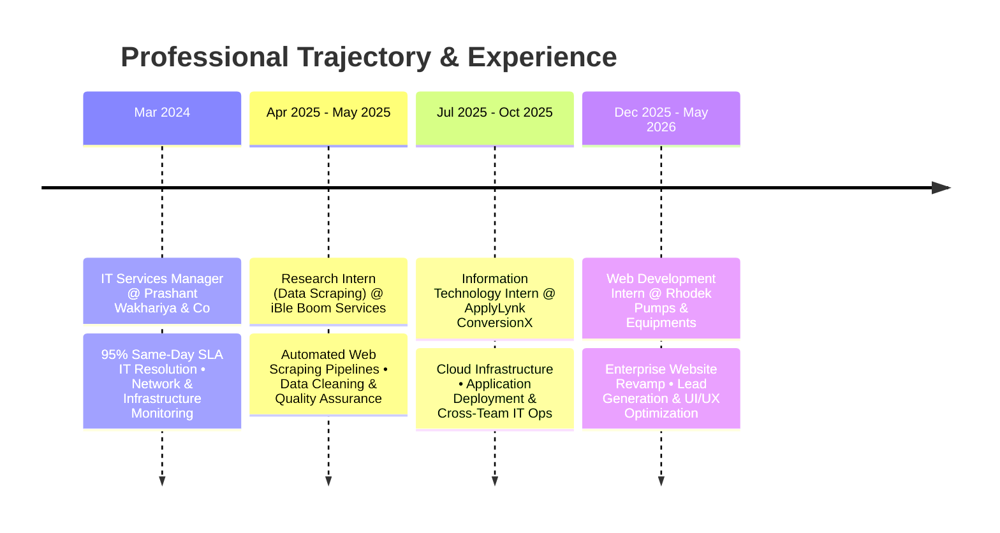

<div align="center">

<!-- Hero Waving Header Banner -->


<br/>

<!-- Dynamic Animated Typing Banner -->
<a href="https://github.com/Romil157">
  
</a>

<br/><br/>

<!-- Status Pill Badges -->
[](mailto:romildoshi1999@gmail.com)
[-0969da?style=for-the-badge&logo=academia&logoColor=white)](https://mu.ac.in)
[](https://maps.google.com/?q=Mumbai)

<br/>

<!-- Interactive Quick Links -->
[](https://www.linkedin.com/in/romil-doshi147/)
[](mailto:romildoshi1999@gmail.com)
[](https://github.com/Romil157)
[](https://github.com/Romil157)

<br/>

<p align="center">
  <a href="#-about-me"></a>
  <a href="#-terminal-profile"></a>
  <a href="#-core-engineering-pillars"></a>
  <a href="#-technical-arsenal"></a>
  <a href="#-featured-projects"></a>
  <a href="#-professional-experience"></a>
  <a href="#-hackathons--competitions"></a>
  <a href="#-github-analytics"></a>
  <a href="#-connect--collaborate"></a>
</p>

<p align="center">
  <b><a href="#-about-me">About Me</a></b> &nbsp;•&nbsp;
  <b><a href="#-terminal-profile">Terminal</a></b> &nbsp;•&nbsp;
  <b><a href="#-core-engineering-pillars">Core Pillars</a></b> &nbsp;•&nbsp;
  <b><a href="#-technical-arsenal">Tech Stack</a></b> &nbsp;•&nbsp;
  <b><a href="#-featured-projects">Projects</a></b> &nbsp;•&nbsp;
  <b><a href="#-professional-experience">Experience</a></b> &nbsp;•&nbsp;
  <b><a href="#-hackathons--competitions">Hackathons</a></b> &nbsp;•&nbsp;
  <b><a href="#-github-analytics">Analytics</a></b> &nbsp;•&nbsp;
  <b><a href="#-connect--collaborate">Contact</a></b>
</p>

</div>

---

## 👨‍💻 About Me

Final-year **Computer Engineering** undergraduate (**B.Tech, Expected 2027**) at the **University of Mumbai** with proven industry experience across **backend architecture, high-volume data scraping & cleaning pipelines, browser edge security, and applied AI/ML systems**.

- 🎓 **Education:** Final-Year B.Tech in Computer Engineering — **University of Mumbai** *(2023 – 2027)*
- 💡 **Engineering Philosophy:** Designing resilient, low-latency systems that turn messy real-world data into structured intelligence and deliver on-device user protection.
- 🛡️ **Edge Security & AI:** Creator of **[Trustos](https://github.com/Romil157/trustos-project)** (zero-trust browser extension combining WebAssembly and local Bloom filters) and **[Sentinel Verify](https://github.com/Romil157/sentinel)** (an AI/NLP-driven threat classification SaaS).
- 🏆 **Global Finalist:** Ranked **#445 of 12,885+ registrants across 48 countries (Top 3.4%)** at **HackerRank Orchestrate Hackathon 2026** for building an autonomous multi-ecosystem AI support triage agent.
- 💼 **Industry Background:** 4 professional internships and roles covering web platform revamps, enterprise cloud & IT infrastructure support, automated data pipelines, and technical systems administration.
- 🎯 **Looking For:** **Software Development Engineer (SDE) / Data / Applied AI-ML Internships** *(Mumbai or Remote)*.

---

## 💻 Terminal Profile

```bash
romil@developer-workstation:~$ romil --status
[✓] Status       : Actively interviewing for Software / Data / AI-ML Internships
[✓] University   : University of Mumbai (B.Tech Computer Engineering, 2027)
[✓] Global Rank  : #445 of 12,885+ (HackerRank Orchestrate Hackathon 2026)
[✓] Key Projects : Trustos (Edge Wasm Phishing Detection), Sentinel Verify (AI/NLP SaaS)
[✓] Core Toolkit : Python, SQL, JavaScript, Flask, Scikit-learn, Web Scraping, Bloom Filters

romil@developer-workstation:~$ romil --get-stats
+------------------------------------+------------------------------------+
| METRIC                             | VALUE                              |
+------------------------------------+------------------------------------+
| Industry Internships / Roles       | 4 Companies                        |
| IT SLA Resolution Rate             | 95% Same-Day Turnaround            |
| Global Hackathon Leaderboard       | Top 3.4% Worldwide                 |
| Edge Threat Detection Latency      | < 1ms (On-Device Local Filter)     |
+------------------------------------+------------------------------------+

romil@developer-workstation:~$ romil --contact
Email    : romildoshi1999@gmail.com
LinkedIn : https://www.linkedin.com/in/romil-doshi147/
Location : Mumbai, Maharashtra, India (Open to Relocation & Remote)
```

---

## 🏛️ Core Engineering Pillars

<table>
  <tr>
    <td width="50%" valign="top">
      <h3>🛠️ Backend & Full-Stack Systems</h3>
      <p>Building high-throughput REST APIs, robust web architectures, and responsive user interfaces with Flask, Node.js, and modern JavaScript with strict focus on performance and reliability.</p>
      <p><code>Flask</code> • <code>Node.js</code> • <code>RESTful APIs</code> • <code>SQLAlchemy</code> • <code>HTML5/CSS3</code></p>
    </td>
    <td width="50%" valign="top">
      <h3>📊 Data Engineering & Scraping</h3>
      <p>Designing automated multi-threaded web scrapers, ETL pipelines, and validation engines to extract, sanitize, and structure raw web data into research-grade datasets.</p>
      <p><code>Data Scraping</code> • <code>Data Cleaning</code> • <code>Pandas</code> • <code>NumPy</code> • <code>SQL</code></p>
    </td>
  </tr>
  <tr>
    <td width="50%" valign="top">
      <h3>🧠 Applied AI, NLP & RAG</h3>
      <p>Developing intelligent triage systems, ensemble ML classifiers, and contextual vector search engines with explainable decision layers (XAI) and deterministic safety filters.</p>
      <p><code>Scikit-learn</code> • <code>NLP (SpaCy)</code> • <code>RAG Systems</code> • <code>LLM Agents</code> • <code>XAI</code></p>
    </td>
    <td width="50%" valign="top">
      <h3>🛡️ Edge Security & Browser Systems</h3>
      <p>Engineering zero-trust client-side tools using WebAssembly, Bloom filters, and Shadow DOM encapsulation for sub-millisecond edge protection without data exfiltration.</p>
      <p><code>WebAssembly</code> • <code>Manifest V3</code> • <code>Bloom Filters</code> • <code>Shadow DOM</code> • <code>SIEM</code></p>
    </td>
  </tr>
</table>

---

## 🛠️ Technical Arsenal

<div align="center">

| Category | Technologies & Tools |
| :--- | :--- |
| **Languages & Core** | `Python` `JavaScript (ES6+)` `SQL` `Node.js` `WebAssembly (Wasm)` `HTML5` `CSS3` `Bash / Shell` |
| **Backend & Web** | `Flask` `RESTful APIs` `Express.js` `SQLAlchemy` `Shadow DOM` `Chrome Extension APIs (MV3)` `Responsive UI` |
| **AI, ML & Data** | `Scikit-learn` `NLP (SpaCy)` `RAG Architectures` `LLM Agents` `Pandas` `NumPy` `Data Scraping (Selenium/BS4)` `Data Cleaning` |
| **Security & Systems** | `Bloom Filters & Hashing` `SIEM Tools` `Zero-Trust Edge Security` `Network Fundamentals (TCP/IP, DNS)` `JWT / Auth` |
| **DevOps & Tools** | `Git` `GitHub` `VS Code` `Postman` `MS Office Suite` `Advanced Excel` `Linux Environment` |

<br/>

### 🏷️ Curated Skill Badges

#### 💻 Programming Languages & Runtime


#### 🤖 AI, Machine Learning & Data Engineering


#### ⚙️ Security, Tools & Platforms


</div>

---

## 🚀 Featured Projects

<table>
  <tr>
    <td width="50%" valign="top">
      <div align="center">
        <h3>🛡️ <a href="https://github.com/Romil157/trustos-project">Trustos</a></h3>
        <p><strong>Zero-Trust Chrome Phishing Detection Extension</strong></p>
        
        
        
      </div>
      <br/>
      <ul>
        <li><strong>Sub-Millisecond Edge Defense:</strong> Real-time protection against credential harvesting without transmitting sensitive URLs or user history to external servers.</li>
        <li><strong>High-Speed Matching Engine:</strong> Combines heuristic risk algorithms, a high-performance <strong>WebAssembly (Wasm)</strong> compute module, and a local <strong>Bloom filter</strong> for zero-latency URL checking.</li>
        <li><strong>Shadow DOM Warning System:</strong> Built an isolated Shadow DOM warning overlay that clearly explains granular threat factors (spoofed login inputs, high entropy domains) rather than silently blocking pages.</li>
      </ul>
      <p align="center">
        <code>JavaScript</code> • <code>WebAssembly</code> • <code>Manifest V3</code> • <code>Bloom Filter</code> • <code>Shadow DOM</code>
      </p>
    </td>
    <td width="50%" valign="top">
      <div align="center">
        <h3>⚡ <a href="https://github.com/Romil157/sentinel">Sentinel Verify</a></h3>
        <p><strong>AI-Powered Cybersecurity SaaS Platform</strong></p>
        
        
        
      </div>
      <br/>
      <ul>
        <li><strong>Ensemble Threat Engine:</strong> Full-stack intelligent platform detecting phishing, fraud, and deceptive content in real time using a trained <strong>Machine Learning & NLP pipeline</strong>.</li>
        <li><strong>Explainable AI (XAI):</strong> Delivers transparent, explainable threat breakdowns illustrating exactly why content was flagged with confidence metrics.</li>
        <li><strong>Enterprise Architecture:</strong> Features secure role-based auth, rate-limited API access controls, scan history logging, and an interactive <strong>analytics dashboard</strong> tracking real-time attack trends.</li>
      </ul>
      <p align="center">
        <code>Python</code> • <code>Flask</code> • <code>Scikit-learn</code> • <code>NLP (SpaCy)</code> • <code>JavaScript</code> • <code>SQLAlchemy</code>
      </p>
    </td>
  </tr>
  <tr>
    <td width="50%" valign="top">
      <div align="center">
        <h3>🤖 <a href="https://github.com/Romil157">Autonomous Support Triage Agent</a></h3>
        <p><strong>HackerRank Orchestrate Hackathon 2026 Global Finalist</strong></p>
        
        
      </div>
      <br/>
      <ul>
        <li><strong>24-Hour Hackathon Delivery:</strong> Built an autonomous terminal-based AI triage agent resolving support tickets across <strong>HackerRank, Claude, and Visa</strong> ecosystems.</li>
        <li><strong>Context-Grounded RAG Pipeline:</strong> Integrated semantic retrieval over knowledge bases with deterministic rule filtering to eliminate hallucinated answers.</li>
        <li><strong>Intelligent Escalation Logic:</strong> Automated priority tagging and human-in-the-loop escalation routing for complex incidents, scoring in the <strong>Top 3.4% globally</strong>.</li>
      </ul>
      <p align="center">
        <code>Python</code> • <code>RAG</code> • <code>Autonomous Agents</code> • <code>Vector Retrieval</code> • <code>Prompt Engineering</code>
      </p>
    </td>
    <td width="50%" valign="top">
      <div align="center">
        <h3>🩺 <a href="https://github.com/Romil157/SymptomSense">SymptomSense</a></h3>
        <p><strong>Health Informatics & Intelligent Symptom Analysis</strong></p>
        
        
      </div>
      <br/>
      <ul>
        <li><strong>Intelligent Symptom Triage:</strong> Web application designed for rapid preliminary symptom assessment, mapping patient inputs against evidence-based medical indicators.</li>
        <li><strong>Interactive Health Profile:</strong> Offers user-centric health tracking, contextual medical guidance, and scheduled medication adherence reminders.</li>
        <li><strong>Responsive & Modular:</strong> Engineered clean modular backend endpoints and an intuitive, mobile-friendly interface for effortless patient interaction.</li>
      </ul>
      <p align="center">
        <code>JavaScript</code> • <code>Node.js</code> • <code>Health Informatics</code> • <code>REST APIs</code> • <code>UI/UX</code>
      </p>
    </td>
  </tr>
</table>

---

## 💼 Professional Experience



<br/>

| Role & Organization | Period | Key Highlights & Quantified Impact |
| :--- | :--- | :--- |
| **🌐 Web Development Intern**<br/>*Rhodek Pumps & Equipments* | `Dec 2025 – May 2026`<br/>*(Mumbai, India)* | • Spearheaded full overhaul and ongoing maintenance of the enterprise website, enhancing conversion rates and client engagement.<br/>• Architected inbound lead generation funnels and streamlined client inquiry workflows, converting organic traffic into tangible business leads.<br/>• Maintained 100% compliance with corporate branding, SEO best practices, and responsive design. |
| **☁️ Information Technology Intern**<br/>*ApplyLynk ConversionX Pvt. Ltd.* | `Jul 2025 – Oct 2025`<br/>*(Mumbai, India)* | • Handled internal IT operations, resolving infrastructure bottlenecks and supporting continuous application deployments in a fast-paced startup.<br/>• Maintained developer environment setups and cross-team troubleshooting workflows with zero downtime. |
| **📊 Research Intern (Data Scraping)**<br/>*iBle Boom Services Pvt. Ltd.* | `Apr 2025 – May 2025`<br/>*(Mumbai, India)* | • Developed automated multi-source web scrapers to gather unstructured market data from complex web portals.<br/>• Created comprehensive data cleaning, deduplication, and validation pipelines, generating reliable ground-truth datasets for research models. |
| **🖥️ IT Services Manager**<br/>*Prashant Wakhariya & Co* | `Mar 2024`<br/>*(Mumbai, India)* | • Monitored LAN/WAN network health and provided technical support for 10+ on-premise workstations.<br/>• Achieved a **95% same-day SLA resolution rate** across hardware diagnostics, software provisioning, and security configurations. |

---

## 🏆 Hackathons & Competitions

| Event & Organizer | Achievement & Rank | Key Innovation / Stack |
| :--- | :--- | :--- |
| 🏆 **HackerRank Orchestrate 2026** | **Global Finalist (Rank #445 / 12,885+)** | Autonomous AI Support Triage Agent with RAG & Deterministic Escalation |
| 🛰️ **ISRO Bharatiya Antariksh Hackathon** | **Finalist Team (4-Person Build)** | SAR-Optical Conditional GAN for Satellite Cloud Removal (LISS-IV) |
| 📊 **Redrob Data & AI Challenge 2025** | **Team Viking47** | Intelligent Candidate Matching & Resume Ranking Engine |
| 💻 **DeepThought SDE Challenge** | **Live-Coding Finalist** | Full-Stack React App with Deepgram Speech-to-Text & Auth |

<br/>

- 🥇 **HackerRank Orchestrate Hackathon 2026** — Engineered a production-ready AI triage agent for HackerRank, Claude, and Visa ticket streams in 24 hours. Ranked **#445 of 1,349 finalists** across **12,885+ registrants from 48 countries**.
- 🛰️ **ISRO Bharatiya Antariksh Hackathon** — Built a Generative Adversarial Network (cGAN) system merging SAR and optical satellite imagery to eliminate cloud cover on Indian LISS-IV sensor datasets (4-person team).
- 📈 **Redrob India Runs Data & AI Challenge 2025** *(Team Viking47)* — Created an algorithmic resume parsing and candidate ranking model optimizing recruitment pipeline throughput.
- ⚡ **DeepThought SDE Challenge** — Developed a responsive application integrating real-time voice transcription (Deepgram) and cloud authentication.

---

## 📊 GitHub Analytics

<div align="center">

<!-- GitHub Stats & Top Languages -->
<table border="0">
  <tr>
    <td align="center">
      
    </td>
    <td align="center">
      
    </td>
  </tr>
</table>

<br/>

<!-- Streak Stats -->


<br/>

<!-- GitHub Activity Graph -->


<br/>

<!-- Trophies -->


</div>

---

## 📬 Connect & Collaborate

<div align="center">

Ready to collaborate on high-impact software, data engineering, or machine learning initiatives? Let's connect!

<br/>

[](https://www.linkedin.com/in/romil-doshi147/)
[](mailto:romildoshi1999@gmail.com)
[](https://github.com/Romil157)

<br/>

📍 **Mumbai, Maharashtra, India** &nbsp;|&nbsp; 📱 **(+91) 9769470770** &nbsp;|&nbsp; ✉️ **romildoshi1999@gmail.com**

<br/>

```javascript
const romil = {
  status: "Available for SDE / Data / AI-ML Internships",
  location: "Mumbai, India",
  interests: ["Backend Architecture", "WebAssembly", "Data Pipelines", "Applied ML & RAG"],
  sayHi: () => console.log("Let's build something remarkable together!")
};
romil.sayHi();
```

<br/>

<!-- Footer Waving Banner -->


<br/>

<sub>⭐ *Crafted with passion by [Romil Doshi](https://github.com/Romil157) — Star this profile if you find it inspiring!*</sub>

</div>
